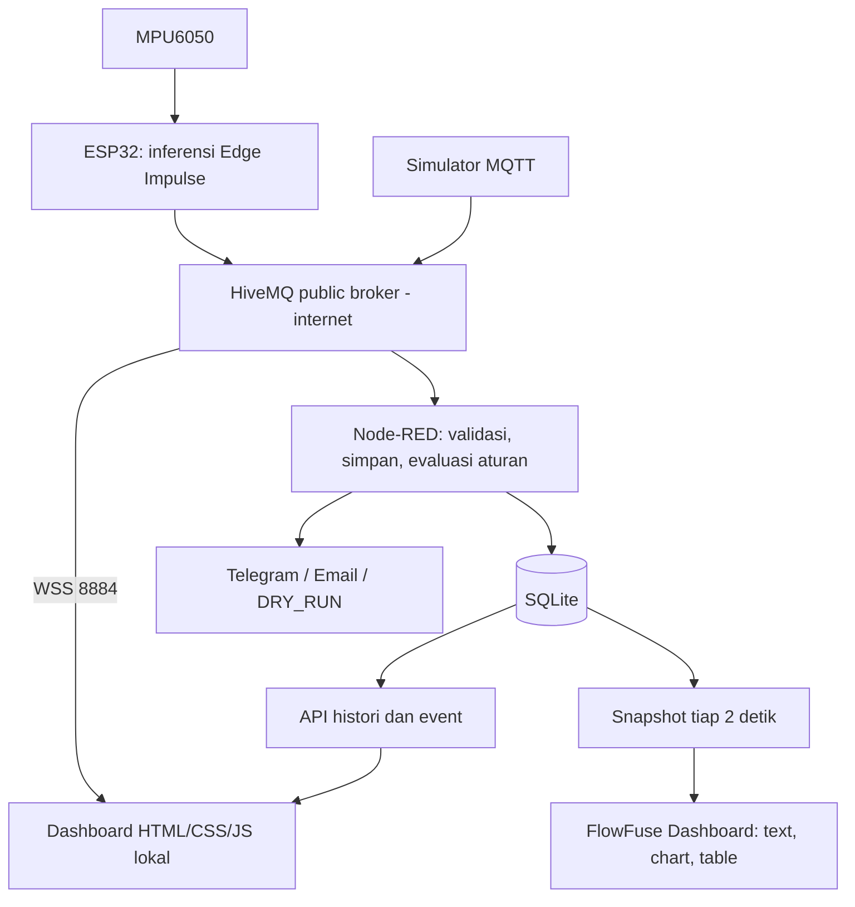

# AIoT Hands On Camp — Kode & Resource Pelatihan

Repo ini menampung kode dan resource praktik lintas pertemuan. **Day 4 adalah presentasi project, bukan sesi implementasi tambahan.** Dashboard, database, dan automasi berada di Day 3.

## Peta materi

| Pertemuan | Fokus | Lokasi saat ini |
| --- | --- | --- |
| Day 1 | Cloud AI: Wokwi ESP32, DHT22/LDR/PIR → ThingSpeak → neural network MATLAB → aktuator/notifikasi; training di Colab | [Repo Day 1](https://github.com/andrewflash/indobot-aiot-hoc-sep-2026-day-1), clone lokal `../Day1/repo/`; slide di `../Day1/` |
| Day 2 | Pengumpulan data MPU6050, training Edge Impulse, inferensi pada ESP32 | `DATA_COLLECTOR/`, `VIBRATION_INFERENCE_APP/`; slide dan export model terbaru di `../Day2/` |
| Day 3 | MQTT, dashboard custom vs Node-RED, SQLite, automasi dari output AI | `DASHBOARD/`, `BACKEND/`, `VIBRATION_INFERENCE_MQTT_APP/`, `docs/`; slide di `../Day3/` |
| Day 4 | Presentasi dan demonstrasi project peserta | [Checklist presentasi](docs/DAY4.md); tidak ada modul implementasi Day 4 |

Folder materi `Day1`, `Day2`, `Day3` berada **di luar root repo ini**, sesuai workspace pengajar; tidak otomatis ikut ketika repo ini dibagikan. Clone Day 1 terpisah, belum digabung ke repo ini. **React pada Day 1 adalah fitur aturan ThingSpeak**, bukan frontend React.js. Payload Day 1 berbeda dari payload getaran Day 3: diperlukan adapter untuk menghubungkannya ke dashboard ini.

Jalur demo Day 3 melanjutkan Day 2: **MPU6050 → model Edge Impulse di ESP32 → MQTT → dashboard, SQLite, dan automasi**.
Model tidak dipindah ke server dan tidak memanggil chatbot saat runtime. Output demo adalah deteksi anomali, bukan ramalan probabilitas kerusakan dalam dua jam.

## Mulai tanpa perangkat (Windows / PowerShell)

Pasang Node.js **22.17 atau lebih baru** (gunakan rilis LTS yang didukung Node-RED). Node 22 menampilkan peringatan experimental untuk `node:sqlite`; database tetap dapat digunakan. SQLite bawaan Node dipilih agar tidak perlu mengompilasi add-on database atau memasang server SQL.

Di folder `BACKEND`, jalankan sekali:

```powershell
npm.cmd ci
if (-not (Test-Path .env)) { Copy-Item .env.example .env }
```

Default demo memakai **broker publik HiveMQ**, bukan broker lokal. Jalankan `npm.cmd run broker:public` sekali untuk mengatur host/WebSocket dan prefix unik di `.env` tanpa menimpa kredensial lain. Jika Node-RED sudah aktif, hentikan dahulu. Ikuti [panduan broker publik dan langkah demo slide](docs/PUBLIC-MQTT.md).

Lalu buka **dua terminal**, semuanya di folder `BACKEND`:

| Terminal | Perintah | Fungsi |
| --- | --- | --- |
| 1 | `npm.cmd start` | Node-RED, API, kedua dashboard, dan SQLite lokal |
| 2 | `npm.cmd run simulate` | Publisher ke HiveMQ; tidak diperlukan jika memakai ESP32 |

Buka salah satu atau keduanya:

- **Custom HTML/CSS/JS:** http://127.0.0.1:1880/ — klik **Hubungkan**.
- **Node-RED / FlowFuse Dashboard:** http://127.0.0.1:1880/api/dashboard/monitor — otomatis membaca perangkat dari `DEVICE_ID`.
- **Editor flow:** http://127.0.0.1:1880/red/ — untuk menyusun flow, bukan halaman dashboard peserta.

Kedua dashboard menggunakan SQLite dan automasi yang sama; membuka keduanya tidak menggandakan notifikasi. Dashboard Node-RED memperbarui snapshot tiap 2 detik; histori custom tiap 5 detik.

**Upgrade versi sebelumnya:** hentikan Node-RED, jalankan `npm.cmd ci` lalu `npm.cmd run dashboard:install` di BACKEND, kemudian start kembali. Installer menambah tab baru ke runtime dengan backup, tanpa menimpa flow yang sudah diedit. Instalasi pertama langsung menggunakan template lengkap.
Tunggu sekitar 10 detik: lihat event ALARM, kemudian RECOVERY. Histori dimuat ulang otomatis tiap 5 detik.
`DRY_RUN` berarti aturan berjalan tetapi tidak mengirim pesan eksternal.

Dependensi diunduh saat `npm ci`; dashboard memakai library lokal, bukan CDN. MQTT publik dan Telegram/email membutuhkan internet. Broker lokal masih tersedia sebagai cadangan offline dan untuk tes otomatis; bukan bagian startup demo utama.

## Struktur

```text
DASHBOARD/                       UI HTML/CSS/JS, grafik dan tabel histori
BACKEND/
  flows.json                     Flow awal Node-RED (siap dipakai bersama settings.js)
  settings.js                    Hosting UI, API, binding localhost, service SQLite
  lib/workshop.js                Validasi, transaksi SQLite, aturan per perangkat
  lib/notifications.js           Telegram, SMTP, dan dry-run
  scripts/broker.js              Broker kelas tanpa autentikasi, lokal secara default
  scripts/simulate.js            Publisher simulasi MQTT
  scripts/build-flows.js         Sumber generator flows.json
  scripts/dashboard-flow.js     Widget standar FlowFuse Dashboard (read-only)
  scripts/install-dashboard.js  Tambah dashboard ke runtime lama dengan backup
  test/                          Tes aturan, database, integrasi dan browser
  data/                          Database otomatis, tidak masuk git
  runtime/                       Flow kerja editor, tidak masuk git
VIBRATION_INFERENCE_MQTT_APP/     Firmware tambahan untuk Day 3
VIBRATION_INFERENCE_APP/          Firmware Day 2 asli
DATA_COLLECTOR/                  Collector Day 2 asli
docs/                           Panduan praktik dan kontrak data
```

Kode asli collector/inferensi dipertahankan. Nama teknis lama seperti `day34`, `day34.css`, dan nama package backend tetap untuk kompatibilitas; semuanya merujuk implementasi Day 3.

## Hubungkan ESP32 asli

1. Hentikan simulator dengan Ctrl+C agar tidak memakai ID yang sama dengan perangkat.
2. Di `BACKEND/.env`, gunakan MQTT_HOST=broker.hivemq.com, MQTT_PORT=1883, MQTT_WS_URL=wss://broker.hivemq.com:8884/mqtt.
3. ESP32 dan laptop memerlukan internet, tetapi tidak harus satu LAN. Tidak perlu membuka inbound port laptop.
4. Ikuti [panduan firmware](VIBRATION_INFERENCE_MQTT_APP/README.md): isi host HiveMQ dan samakan MQTT_PREFIX dengan prefix unik di `.env`.
5. Gunakan ID unik per kelompok. Cocokkan topic dashboard dan isian **Device histori**. Untuk mengubah default perangkat, atur `DEVICE_ID` di `.env`, restart Node-RED lalu refresh dashboard.

`127.0.0.1` di ESP32 berarti ESP32 itu sendiri, bukan laptop. Node-RED/editor tetap hanya tersedia di laptop lokal. Melayani banyak pengguna melalui LAN/cloud membutuhkan konfigurasi autentikasi dan TLS tambahan; itu di luar demo dasar.

## Arsitektur



Menutup browser tidak menghentikan pencatatan/automasi. Menutup Node-RED atau mematikan laptop menghentikannya.

## Apa yang dipelajari

- [Day 3: dashboard, database, dan automasi](docs/DAY3.md)
- [HiveMQ publik: setup, batas keamanan, dan langkah demo slide](docs/PUBLIC-MQTT.md)
- [Dashboard Node-RED: tutorial dan perbandingan custom](docs/NODE-RED-DASHBOARD.md)
- [Automasi Day 3: aturan dan Telegram/email](docs/AUTOMATION.md)
- [Day 4: checklist presentasi project](docs/DAY4.md)
- [Backend dan pengelolaan flow](BACKEND/README.md)
- [Kontrak MQTT, API dan database](docs/DATA-CONTRACT.md)
- [Prompt AI untuk peserta](docs/PROMPTS.md)

## Memilih dashboard

| Kebutuhan | Custom HTML/CSS/JS | Node-RED Dashboard |
| --- | --- | --- |
| Cara membuat | Kode frontend, dibantu prompt AI | Widget low-code, group/page dan wiring |
| Kelebihan | Bebas mengatur desain/interaksi | Cepat untuk belajar alur dan prototipe |
| Data demo | Realtime MQTT WebSocket; histori API | Snapshot SQLite setiap 2 detik |
| Filter perangkat | Topic dan histori di browser | Satu DEVICE_ID server bersama |
| Database/automasi | Node-RED + SQLite | Backend yang sama |

Mulai dari Node-RED untuk memahami alur, lalu custom untuk latihan desain UI berbantuan AI. Keduanya berjalan lokal tanpa langganan cloud. Database, aturan dan notifikasi tidak otomatis disediakan widget; semuanya membutuhkan backend di repo ini.

## Batas demo

- Broker HiveMQ publik tidak memiliki autentikasi; pihak lain dapat membaca/memalsukan payload dan memicu alert. Prefix unik bukan akses kontrol. TCP 1883 tidak terenkripsi; jangan kirim rahasia/data sensitif. Tidak untuk produksi/aktuator. Broker lokal cadangan juga tanpa autentikasi/TLS, hanya untuk jaringan tepercaya.
- SQLite menyimpan setiap inferensi yang diterima; belum ada retensi otomatis. Perkiraan ukuran bergantung pada payload/frekuensi. Gunakan dataset kelas terbatas dan arsipkan database bila perlu.
- Notifikasi adalah best-effort dengan timeout dan status delivery, bukan antrean pengiriman durable/retry. Event tersimpan lebih dulu. Crash sebelum pengiriman bisa meninggalkan event tanpa delivery; jangan menganggapnya terkirim.
- MQTT QoS 0 tidak menjamin semua pesan diterima. Saat backend mati, pesan yang lewat tidak otomatis dipulihkan. Retained payload ditolak untuk automasi karena bukan bukti inferensi baru.
- Firmware baru menyertakan boot_id dan seq. Payload Day 2 tetap diterima, tetapi tanpa timestamp/boot_id sistem tidak bisa membuktikan umur data dari sumber; memakai waktu penerimaan dan pemeriksaan uptime.
- Model Day 2 perlu anomaly detection aktif. Skor anomali tidak selalu 0–1 dan tidak ditampilkan sebagai persentase kerusakan.

## Verifikasi

```powershell
cd BACKEND
npm.cmd test
```

Tes memakai database sementara dan port lokal acak; notifikasi eksternal dinonaktifkan. Uji browser memakai Chrome lokal (default path Windows) atau `CHROME_PATH`; jika tidak ada, bagian browser dilewati dan dilaporkan. Tidak ada upload firmware maupun pengiriman Telegram/email oleh tes.

Flow awal disalin ke `BACKEND/runtime/flows.json` saat pertama dijalankan. Perubahan di editor disimpan di runtime; `BACKEND/flows.json` tetap template distribusi. Untuk menyimpan modifikasi pengajar, export flow dari editor. Function nodes template bergantung pada `settings.js` dan `lib/`, sehingga mengimpor JSON saja ke instalasi lain belum cukup.
